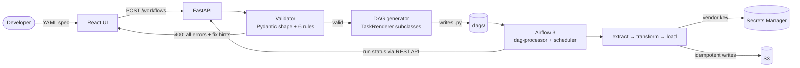

# Mini Workflow Platform

[](https://github.com/Rusheekb/mini-workflow-platform/actions/workflows/ci.yml)

A small, spec-driven workflow platform on **Apache Airflow 3**. Teams describe a workflow in a short YAML spec; the
platform validates it (reporting *every* problem with a fix hint), generates an Airflow DAG from it, and Airflow runs
it, either as local tasks or as Kubernetes pods. A FastAPI service and a React UI sit in front, and the example
pipeline reads a secret from AWS Secrets Manager and writes to S3 using a least-privilege IAM identity.

**Stack:** Python 3.12 · Airflow 3.3 · FastAPI · Pydantic v2 · React 19 (Vite) · Docker Compose · Kubernetes ·
AWS (S3, Secrets Manager, ECR, IAM) · pytest · GitHub Actions

## Architecture



## The spec

```yaml
workflow_name: daily_exchange_rates
schedule: "@daily"            # preset or cron, e.g. "0 6 * * *"
owner: rusheek
retries: 3
tags: [finance]
tasks:
  - id: extract
    image: mwp-tasks:0.1.0    # pinned tag required (no :latest)
    command: ["python", "extract.py"]
    memory_limit: 512Mi       # becomes a Kubernetes memory limit
  - id: transform
    image: mwp-tasks:0.1.0
    command: ["python", "transform.py"]
    depends_on: [extract]
  - id: load
    image: mwp-tasks:0.1.0
    command: ["python", "load.py"]
    depends_on: [transform]
```

**Validation** happens in two layers and returns all errors at once, each as `path`, `message`, `hint`:

| Layer | Checks |
|---|---|
| Shape (Pydantic) | required fields, types, unknown fields rejected (catches typos like `depend_on`), identifier-safe names |
| Rules | duplicate task IDs, `depends_on` pointing to unknown tasks, dependency **cycles** (Kahn's algorithm, shows the loop), valid schedule, pinned image tags, memory limit format and range |

```
tasks: dependency cycle: extract >> transform >> load >> extract (fix: remove one depends_on entry in this loop ...)
tasks[0].image: image 'mwp-tasks:latest' uses the :latest tag, which can change under you (fix: pin an explicit version ...)
```

## Design highlights

- **Renderer classes (template method + open/closed).** `TaskRenderer` is an abstract base; `LocalTaskRenderer`
  emits `BashOperator`s and `KubernetesTaskRenderer` emits `KubernetesPodOperator`s with memory requests/limits. The
  generator works with any renderer, so a new target (e.g. AWS Batch) is one new subclass.
- **Generated DAGs follow platform standards:** fixed `start_date`, `catchup=False`, retries and retry delay from the
  spec, tags, no top-level work, pinned images, resource limits on pods.
- **Safe code generation.** Spec values are inserted with `repr()` and commands with `shlex.join`, so a spec can't
  inject Python or shell. DAG files are written atomically (temp file + rename).
- **Idempotent tasks.** Every read/write is keyed by the run date (`run_date=YYYY-MM-DD`), so re-running a day
  overwrites rather than duplicates. Tasks use timeouts, `raise_for_status()`, specific exceptions, and re-raise so
  Airflow retries.
- **API that degrades gracefully.** If Airflow is down, `GET /workflows` still lists workflows with
  `airflow_available: false`. Dependency injection lets tests run against a fake Airflow.
- **Least-privilege AWS.** The task identity can read/write one bucket, read one secret, and push/pull one ECR repo.
  Deleting objects, listing other buckets, changing the secret, and IAM calls are all denied (verified).

## Repository layout

```
backend/     spec models, validator, DAG generator + renderers, FastAPI app, Airflow REST client
dags/        generated DAG files (Airflow reads this folder)
specs/       example valid/invalid specs (used by tests) and specs submitted through the API
tasks/       task scripts (extract/transform/load) + shared storage/secrets helpers
frontend/    React UI (Vite)
deploy/      docker-compose, kind config, Helm values, Airflow image Dockerfile, AWS IAM policy template
scripts/     AWS setup / teardown, Kubernetes up / down
tests/       validator, generator, API, task storage, and DAG integrity tests
```

## Run it locally

Requires Python 3.12, Docker, and Node 22.

```bash
# 1. Python environment (Airflow's constraints file is applied from requirements.txt)
python3.12 -m venv .venv && source .venv/bin/activate
pip install -r requirements.txt
pytest                                   # validator, generator, API, DAG integrity

# 2. Airflow 3 (LocalExecutor) at http://localhost:8080  (airflow / airflow)
docker compose -f deploy/docker-compose.yaml up -d

# 3. API at http://localhost:8000/docs
uvicorn backend.api:app --reload --port 8000

# 4. UI at http://localhost:5173
cd frontend && npm install && npm run dev
```

Generate a DAG without the API:

```bash
python -m backend.generator specs/valid/daily_exchange_rates.yaml --target local --out dags/
python -m backend.generator specs/invalid/cycle.yaml        # exits 1 and prints every problem
```

### Optional: AWS

```bash
./scripts/setup_aws.sh      # S3 bucket, Secrets Manager secret, ECR repo, least-privilege IAM user -> .env
docker compose -f deploy/docker-compose.yaml up -d --force-recreate
./scripts/teardown_aws.sh   # deletes everything again
```

Resources are tagged `project=mini-workflow-platform`. Without AWS configured, tasks write to a local `data/` folder.

### Kubernetes: tasks as pods (kind + official Helm chart)

```bash
docker compose -f deploy/docker-compose.yaml down    # one Airflow at a time on a laptop
./scripts/k8s_up.sh                                   # kind cluster + images + Helm (KubernetesExecutor)
kubectl port-forward svc/airflow-api-server 8080:8080 -n airflow   # UI: admin / admin
./scripts/k8s_down.sh                                 # delete the cluster
```

`k8s_up.sh` generates the DAGs with `--target kubernetes`, bakes them into a custom Airflow image
(`deploy/airflow.Dockerfile`), builds the task image (`tasks/Dockerfile`, non-root, pinned dependencies), loads both
into kind, creates a Kubernetes Secret with only the values task pods need, and installs chart 1.22.0 with
`deploy/helm-values.yaml`. Each task then runs as its own pod with the spec's memory request/limit;
`specs/demo/oom_demo.yaml` deliberately exceeds its 64Mi limit to show an `OOMKilled` pod (exit code 137).

## How this maps to AWS in production

| Here | In production on AWS |
|---|---|
| Docker Compose / kind | **Amazon EKS** running Airflow via the official Helm chart with the **KubernetesExecutor** (or Amazon MWAA) |
| Postgres container | **Amazon RDS for PostgreSQL** (Multi-AZ) as the metadata database |
| `dags/` bind mount | DAGs baked into the Airflow image by CI, or synced from Git/S3 (git-sync sidecar) |
| Task image built locally | **Amazon ECR** with immutable tags and scan on push |
| IAM user + access key in `.env` | **IRSA / EKS Pod Identity**: each workload's service account maps to an IAM role and gets temporary, auto-rotating credentials (no keys anywhere) |
| Secrets Manager read in task code | Same, plus Airflow's **Secrets Manager secrets backend** for connections and variables |
| Task logs in local files | Remote logging to S3 and **CloudWatch** logs, metrics, and alarms on failed runs |
| GitHub Actions: lint + tests | Same, plus building/pushing images to ECR and deploying via Helm |

## Production roadmap

This is a working slice of a workflow platform, not a production service. These are the next steps, roughly in
priority order, to make it one:

| Area | Next step | Why |
|---|---|---|
| Deploy model | The API opens a pull request to a DAG repository instead of writing files; CI validates and merges deploy via git-sync or an image build | Code review, history, and one-click rollback for every workflow change |
| Auth and ownership | SSO (OIDC) on the API and UI, per-team roles, and workflow ownership checks on every write | Teams can only change their own workflows; every change has an author |
| Storage | Specs stored in Postgres with versions and an audit log instead of files on disk | Survives restarts, supports multiple API replicas, and answers "who changed what, when" |
| Spec evolution | A `spec_version` field with migrations; more task types (sensors, SQL, notifications); failure alerts and SLAs in the spec | The spec can grow without breaking existing workflows |
| Policy checks | Allowed image registries only, per-team memory/CPU quotas, required owner and tags, enforced in the validator | Platform rules applied before anything reaches the cluster |
| Developer experience | Publish the spec as JSON Schema (editor autocomplete), a preview of the generated DAG, and a CLI that validates locally | Errors are caught at the keyboard, not after submitting |
| Observability | Structured JSON logs, metrics, remote task logs in S3/CloudWatch, alarms on failed or late runs, run history and logs in the UI | Teams can debug their own failures without asking the platform team |
| Security | Image scanning as a deploy gate, Airflow's Secrets Manager backend, IRSA/Pod Identity, NetworkPolicies, Pod Security Standards | No long-lived keys, and task pods can only reach what they need |
| Reliability | RDS Multi-AZ, multiple schedulers, PodDisruptionBudgets, namespace resource quotas | No single point of failure; one team's workload can't starve another's |
| Testing | Integration tests against a real Airflow in CI, end-to-end UI tests, and a load test for many DAGs | Confidence that the whole path works, not just each unit |

## Tests and CI

`pytest` covers the validator (including cycle edge cases like self-dependencies and the diamond shape), the
generator (each DAG is loaded with Airflow's own `DagBag` and inspected, including an injection attempt), the API
(with a fake Airflow), task storage (local and fake S3), and a **DAG integrity test** that fails on any import error
or standards violation in `dags/`. GitHub Actions runs all of it plus the frontend lint and build on every push.
